

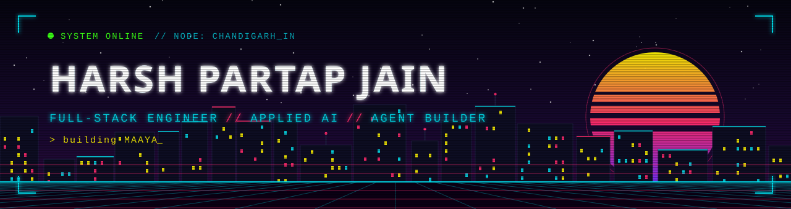

  

  



  

 

  
    🔭 Building <b>MAAYA</b> &nbsp;•&nbsp; 🧪 Samsung <b>PRISM</b> research worklet &nbsp;•&nbsp; 🐧 <b>Linux kernel</b> contributor &nbsp;•&nbsp; 💼 Ex-AI Intern @ <b>Knotsync</b>
  


<table align="center">
<tr>
<td align="center" width="25%"><h3>🌐</h3><b>MODERN WEB APPS</b> Clean UX, fast performance</td>
<td align="center" width="25%"><h3>📱</h3><b>CROSS-PLATFORM MOBILE</b> Shared logic, native feel</td>
<td align="center" width="25%"><h3>⚙️</h3><b>SCALABLE BACKENDS</b> Reliable, no drama</td>
<td align="center" width="25%"><h3>🤖</h3><b>REAL AI FEATURES</b> Problem-solving, not demos</td>
</tr>
</table>


  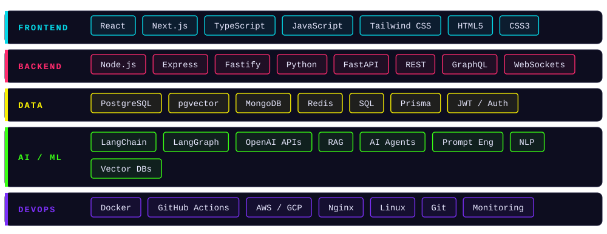

  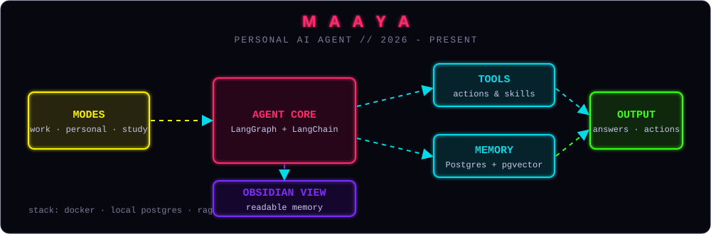


 

  


  

   

  


  

  

